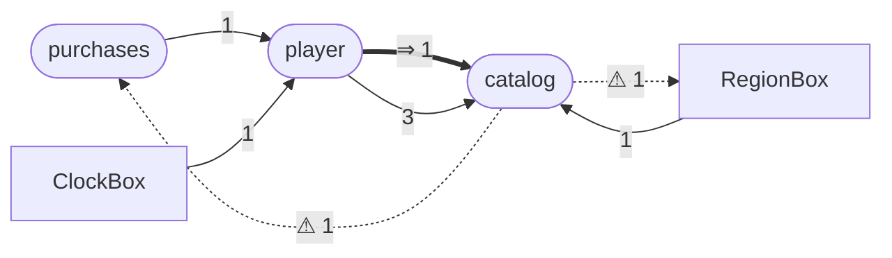

# Graph map

How to read it:

- A box is listed under the graph that drives it (declares it). Any graph may read it. Boxes read here but driven by none of these graphs are listed under *Outside*.
- `←` input wires: the box re-runs when one of these changes. `→` readers: what re-runs when this box changes.
- `⇒` an effect pressed this box's buttons (from its `run`, a timer it started, or after an await) — a legal ring, not a wire.
- `⚠` a hidden link: inside its compute (or cached fetch) a box touched another box — read it or pressed its buttons — where the graph cannot see. Need its value: wire it. Commanding it: move the command into an effect.
- Links appear once they have happened while the map was recorded (debug build). Commands from UI, `listen` and closures outside boxes are not here: a link between boxes that is missing from this map is not a wire.

## Overview

| graph | boxes | effects | reads from other graphs | its effects press |
|---|---|---|---|---|
| `purchases` | 1 | 0 | — | — |
| `player` | 4 | 2 | `ClockBox` 1, `purchases` 1 | `catalog` 1 |
| `catalog` | 6 | 2 | `RegionBox` 1, `player` 3 | itself 2 |

Outside these graphs (read here, driven elsewhere): `ClockBox`, `RegionBox`.

⚠ Hidden links (2): `LabelBox` touched `PremiumBox`; `PopularBox` touched `RegionBox`.

Effects: 4, unnamed: 1 — name them: `addEffect(..., name: '...')`.

Arrow `-->|n|`: n wires read across. `==>|⇒ n|`: effects press n boxes there. `-.->|⚠ n|`: n hidden links.

## `purchases`

Wired in `test/graph_map_test.dart`.

### Boxes

- **`PremiumBox`**
  - ← no input wires
  - → `StreamUrlBox` (`player`)
  - ⚠ touched by `LabelBox` (`catalog`)

## `player`

Wired in `test/graph_map_test.dart`.

### Boxes

- **`SelectionBox`**
  - ← no input wires
  - → `StreamUrlBox`
- **`StreamUrlBox`**
  - ← `PremiumBox` (`purchases`), `SelectionBox`
  - → `PlayerBox`
- **`PlayerBox`** · multibox
  - ← `StreamUrlBox`
  - cell `PlayerBox.status` → `TitleBox`
- **`TitleBox`**
  - ← `PlayerBox.status`
  - → `LabelBox` (`catalog`), `SnapshotBox` (`catalog`), effect `effect_2` (unnamed), effect `now-playing`, effect `stats` (`catalog`)

### Effects

- **effect `now-playing`**
  - ← `ClockBox.banner expires` (outside), `TitleBox`
- **effect `effect_2`** · unnamed
  - ← `TitleBox`
  - ⇒ presses `CounterBox #1` (`catalog`)

## `catalog`

Wired in `test/graph_map_test.dart`.

### Boxes

- **`SearchQueryBox`**
  - ← no input wires
  - ⇐ pressed by effect `region`
  - → no graph reads it (UI or `listen` may)
- **`CounterBox #1`**
  - ← no input wires
  - ⇐ pressed by effect `effect_2` (`player`, unnamed)
  - → no graph reads it (UI or `listen` may)
- **`CounterBox #2`**
  - ← no input wires
  - ⇐ pressed by effect `stats`
  - → no graph reads it (UI or `listen` may)
- **`LabelBox`**
  - ← `TitleBox` (`player`)
  - ⚠ touches: `PremiumBox` (`purchases`)
  - → no graph reads it (UI or `listen` may)
- **`PopularBox`**
  - ← no input wires
  - ⚠ touches: `RegionBox` (outside)
  - → no graph reads it (UI or `listen` may)
- **`SnapshotBox`**
  - ← `TitleBox` (`player`)
  - → no graph reads it (UI or `listen` may)

### Effects

- **effect `region`**
  - ← `RegionBox` (outside)
  - ⇒ presses `SearchQueryBox`
- **effect `stats`**
  - ← `TitleBox` (`player`)
  - ⇒ presses `CounterBox #2`

## Outside these graphs

Read (or pressed) here, driven by none of the graphs above.

- **`ClockBox`** · multibox
  - cell `ClockBox.banner expires` → effect `now-playing` (`player`)
- **`RegionBox`**
  - → effect `region` (`catalog`)
  - ⚠ touched by `PopularBox` (`catalog`)
